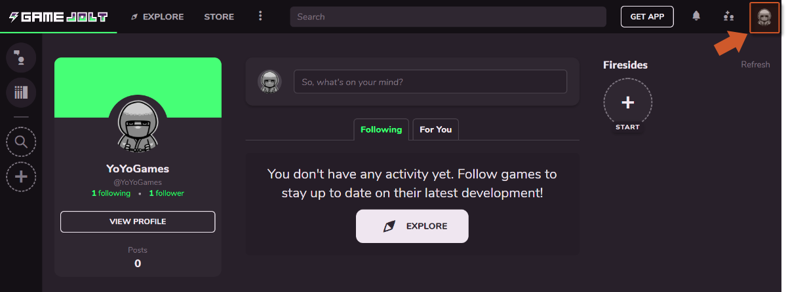
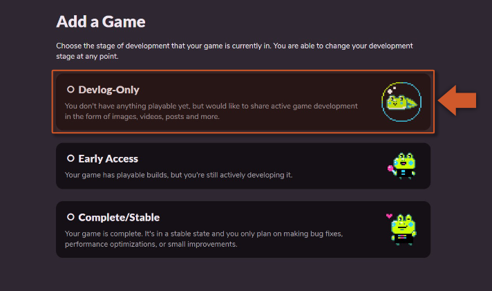
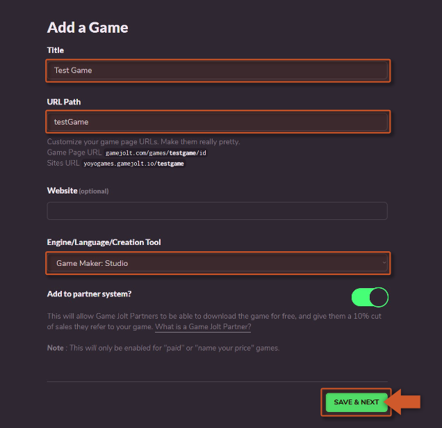
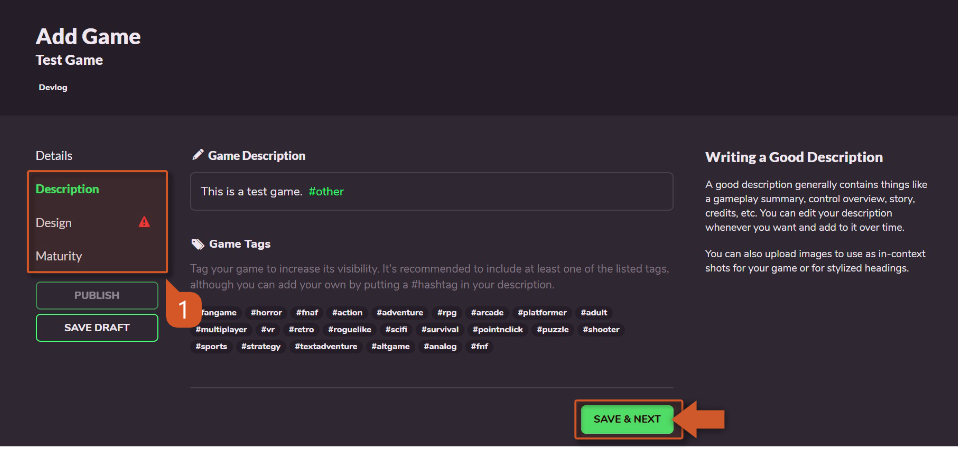
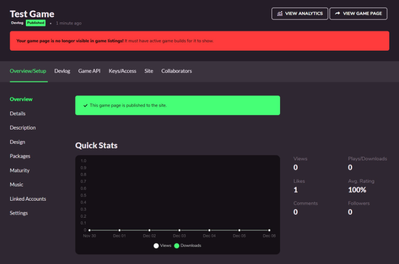

@title GameJolt Setup

# GameJolt Setup

This section will describe the steps for creating your first game using [GameJolt](https://gamejolt.com) webpage.

[[Info: Make sure you have, first of all, created an account.]]

1. To create a new game click on your profile picture (on the top-left corner of the screen): 

2. Select **Add a Game** from the drop down menu.

[[Warning: **IMPORTANT** If that option is NOT available visit [this link](https://gamejolt.com/dashboard/games/add) instead.]]

3. For the purpose of this tutorial we don't have a game yet so we will start by creating a development blog: 

4. Now we can fill in the basic information about the game: **Title**, **URL Path** and **Engine**. After that information is filled just click the **Save & Next** button at the end of the form: 

5. You should now have your project, but we are not done yet we need to go through every topic on the left side menu **(1)** and provide the required metadata information for our game: 

[[Warning: **IMPORTANT** Don't forget to click **Save & Next** on each page to save the settings.]]

6. After everything is filled we should now be able to press the green **Publish** button to finish publishing the game: 

7. We should now have a published game ready to use with the **GameJolt** extension.