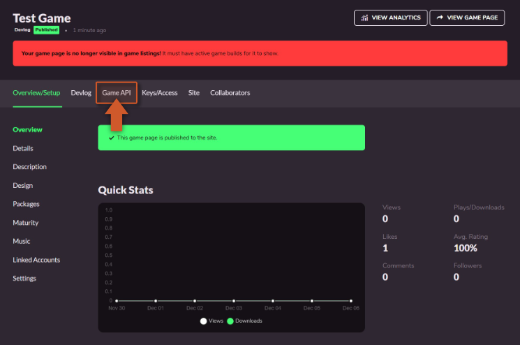
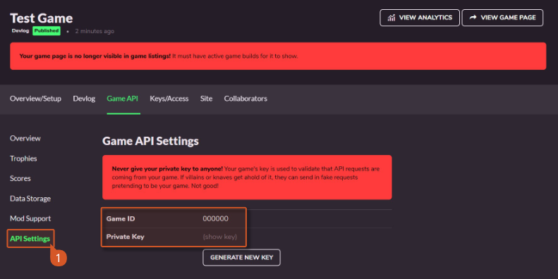
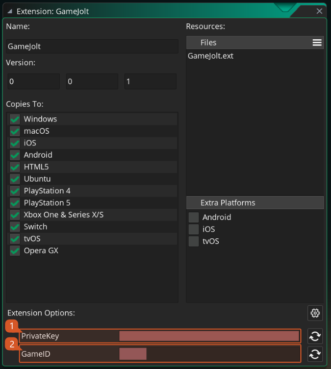

@title Project Setup

# Project Setup

We will now set up the GameMaker project to start using the extension.

[[Note: Make sure you already have a game or have followed the ${page.gamejolt_setup} guide first.]]

1. We need to go into our project management page and select **Game API** from the top menu:

2. On this new page click the **API Settings** panel on the left menu. Here you will find both your **Game ID** and **Private Key** that are required for finishing the extension setup. 

[[Warning: **IMPORTANT** This information should never be shared with anyone. If at some point in time you think it might have been compromised you can and should press the **Generate New Key** button to generate a new one (you will need to update your GameMaker project as well).]]

3. Locate the **GameJolt** extension file within the extension project and double click it to open the extension window. On the bottom of that window you can now fill in the required data for your game: the **Game ID** (1) and the **Private Key** (2) values, obtained above.

4. Done, you are now ready to start using the **GameJolt API** extension.